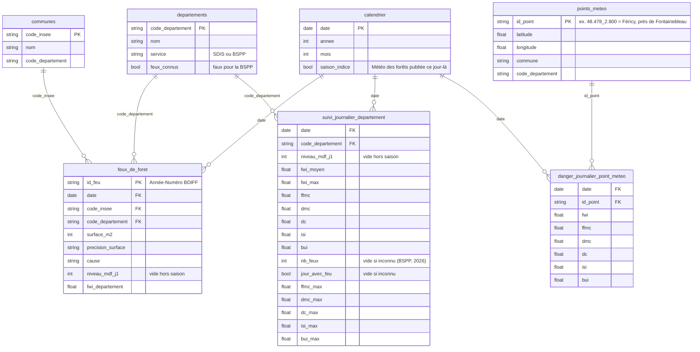

# pipeline/

Consolide les sources en trois couches (conception : `CONCEPTION.md`) :

- **bronze** (`data/bronze/`) : les fichiers bruts, jamais modifiés ;
- **silver** (`data/silver/`, local) : une table propre par source, après les règles de qualité ; lignes rejetées dans `data/silver/rejets/` ;
- **gold** (`data/gold/`, versionné) : le schéma en étoile lu par Power BI, en trois formats : Parquet, CSV (`csv/`) et l'entrepôt DuckDB (`entrepot.duckdb`).

## Lancer

```bash
source .venv/bin/activate      # Windows : .venv\Scripts\activate
pip install -r requirements.txt
python -m pipeline             # reconstruit silver et gold
pytest                         # tests
```

## Interroger l'entrepôt en SQL

`data/gold/entrepot.duckdb` contient les 7 tables gold. DuckDB est une base SQL dans un seul fichier, sans serveur :

```python
import duckdb
con = duckdb.connect('data/gold/entrepot.duckdb', read_only=True)
con.sql("""
    SELECT d.nom, count(*) AS feux
    FROM feux_de_foret f JOIN departements d USING (code_departement)
    GROUP BY d.nom ORDER BY feux DESC
""")
```

Ou en ligne de commande avec le client DuckDB : `duckdb data/gold/entrepot.duckdb`.

Si une règle « bloquer » échoue, le chargement s'arrête avant gold et le détail est dans `data/rapport_qualite.md`.

## Tables gold

| Table | Grain | Sert à |
|---|---|---|
| `calendrier` | un jour | toutes |
| `departements` | un département d'Île-de-France (SDIS ou BSPP) | toutes |
| `communes` | une commune touchée par un feu | G1 |
| `feux_de_foret` | un feu (avec niveau Météo des forêts et FWI du jour) | G1, G3 |
| `suivi_journalier_departement` | un jour × un département (niveau, FWI moyen et max, indices, nombre de feux, jour avec feu) | G2, G4, G5 |
| `points_meteo` | un point de la grille Copernicus (13 en Île-de-France) | G2, G5 |
| `danger_journalier_point_meteo` | un jour × un point (FWI, FFMC, DMC, DC, ISI, BUI) | G2, G5 |

Le pipeline **prépare** les données ; l'analyse (seuils, menu par budget, taux) se fait dans Power BI.

`nb_feux` est vide quand le nombre de feux est inconnu (BSPP, années sans BDIFF), jamais 0.

## Schéma en étoile (pour Power BI)



## Relations à créer dans Power BI

| De (côté 1) | Vers (côté plusieurs) | Colonne | Cardinalité | Filtrage |
|---|---|---|---|---|
| `calendrier` | `feux_de_foret` | `date` | 1 à plusieurs | unique (de la dimension vers le fait) |
| `calendrier` | `suivi_journalier_departement` | `date` | 1 à plusieurs | unique |
| `calendrier` | `danger_journalier_point_meteo` | `date` | 1 à plusieurs | unique |
| `departements` | `feux_de_foret` | `code_departement` | 1 à plusieurs | unique |
| `departements` | `suivi_journalier_departement` | `code_departement` | 1 à plusieurs | unique |
| `communes` | `feux_de_foret` | `code_insee` | 1 à plusieurs | unique |
| `points_meteo` | `danger_journalier_point_meteo` | `id_point` | 1 à plusieurs | unique |

À savoir :
- **Ne pas relier les tables de faits entre elles** : elles se croisent toujours à travers une dimension (date, département).
- **`points_meteo` et `communes` ont aussi une colonne `code_departement`** : ne pas la relier à `departements`, sinon Power BI crée deux chemins de filtrage vers les faits.
- **`calendrier` est une table de dates** : dans Power BI, la marquer comme telle (« Marquer comme table de dates », colonne `date`).
- **Les valeurs vides de `nb_feux` et `jour_avec_feu` veulent dire « inconnu »** : ne pas les remplacer par 0 dans Power BI.
